# roundhouse

A live map of what Claude Code is doing, in a floating window on a Linux desktop
(built for Omarchy / Hyprland). A hub in the middle, stations around it (You, Model,
Memory, Files, Shell, Network, Browser, Agents, Skills, Hooks), and a pulse along a
spoke for every tool call.

Inspired by [lot-map](https://github.com/alexeyw/lot-map) by alexeyw (MIT), a Claude
Code plugin that draws this map in the desktop app. In a terminal session that plugin
shows only its text feed; this project gets the picture on screen anyway, fed by
ordinary Claude Code hooks. The code here is written fresh.

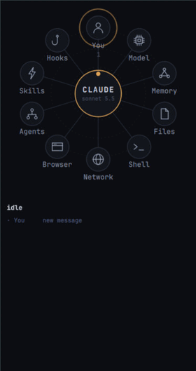

**Quick start:** `./install.sh --dry-run` shows what installing would change (nothing is changed),
`./install.sh` does it after asking, then `roundhouse` opens the window. Details under
[Install](#install); everything it touches is listed there, and so is how to remove it.

**Status: complete.** All five stages are built and tested; see the table.

| Stage | What | State |
| --- | --- | --- |
| 1 | Research and design ([docs/DESIGN.md](docs/DESIGN.md)) | done |
| 2 | Hook emitter and terminal log viewer | done |
| 3 | Window with the static map and live pulses | done |
| 4 | Context ring, route line, error dots, background tasks, subagents, theme, session switcher | done |
| 5 | Per-session windows, the claude-strip link, install and uninstall | done |

## How it works

```
Claude Code hook  ->  hooks/emit.py  ->  $XDG_RUNTIME_DIR/lot-map/events.jsonl  ->  viewer / window
```

`hooks/emit.py` runs on each hook event, turns it into one small JSON line and appends
it to the log. The log lives on tmpfs, is readable only by you, and is cut back to its
newest 500 lines when it passes 1 MB.

## Privacy: what is recorded

Names only, never content:

- a file: the last two parts of its path
- a web address: the host alone
- a shell command: the short description Claude gave it, or the command's name; never
  the command line
- a subagent: its short description
- a background task: its id, type and status
- the context window: a token count and the model name, read from the session
  transcript's usage numbers

Prompts, command lines, file contents, tool output and memory text are never written.
Control characters are stripped from every label. The emitter makes no network calls,
starts no processes, prints nothing and always exits 0, and the hooks are registered as
`async`, so they cannot hold up or alter a tool call. Nothing in roundhouse uses the network.
The log is on tmpfs, readable only by you, and gone at logout.

One exception to "names only", and only on screen: if you use claude-strip, a session's window
shows the strip's task title (a summary of your prompts; see "The session header"). It is read
from the strip's own file, shown, and never written to roundhouse's log.

## Install

```bash
git clone https://github.com/TaylorBurke/roundhouse     # anywhere you like; the commands below run from the clone
cd roundhouse
./install.sh --dry-run     # shows everything it would do, changes nothing
./install.sh               # shows each change and asks before making it
```

Requires Python 3 and, for the window, Quickshell on Hyprland (Omarchy). **What it changes, and
nothing else:**

1. **`~/.claude/settings.json`**: adds one hook for each of the 17 events it listens to (the
   list is in `tools/setup.py`), every one the command `<this folder>/hooks/emit.py` with
   `"async": true`. It backs the file up first (`settings.json.roundhouse-backup-<time>`), prints
   the exact diff and asks. Hooks you already have are left alone; running it again adds nothing.
   (`$CLAUDE_CONFIG_DIR` is honoured.) Open Claude Code sessions need a restart to pick the hooks up.
2. **`~/.local/bin/roundhouse`**: a symlink to `bin/roundhouse`, so the command is on your PATH.
   An existing file of that name that is not ours is never replaced.
3. **`~/.config/hypr/hyprland.lua`** (asks, default no): appends the one line
   `dofile("<this folder>/hypr/roundhouse.lua")  -- roundhouse`, which floats and sizes the windows.
   Without it Hyprland tiles them (the window asks for 360x680 but nothing makes it float), so say yes
   unless you float them some other way.
   It backs the file up, reloads Hyprland and checks `hyprctl configerrors`, and puts the backup
   back if there is any error. You can add that line yourself instead.

At run time the hooks write a small log under `$XDG_RUNTIME_DIR/lot-map` (tmpfs, owner-only, gone at
logout), and the window settings you choose go in `~/.config/roundhouse/config.json`.

## Uninstall

```bash
cd roundhouse              # your clone
./uninstall.sh --dry-run   # shows what it would do
./uninstall.sh             # shows each change and asks first
```

It reverses exactly the three steps above, each with a diff and a backup: removes only the hook
entries whose command is this folder's `hooks/emit.py` (your other hooks stay), removes the
`~/.local/bin/roundhouse` link if it points here, and removes the `dofile` line from
`hyprland.lua`. It also closes the window service and deletes `$XDG_RUNTIME_DIR/lot-map`. It
keeps `~/.config/roundhouse/config.json`, the backups, and this folder, which you can delete.

**By hand**, if the folder is already gone:

```bash
# 1. the hooks: drop every hook whose command ends in /hooks/emit.py (edit the path if yours differs)
cp ~/.claude/settings.json ~/.claude/settings.json.before-roundhouse-removal
jq '.hooks |= (with_entries(.value |= (map(.hooks |= map(select((.command // "") | endswith("/roundhouse/hooks/emit.py") | not))) | map(select(.hooks | length > 0)))) | with_entries(select(.value | length > 0)))' \
  ~/.claude/settings.json.before-roundhouse-removal > ~/.claude/settings.json
# 2. the command
rm ~/.local/bin/roundhouse
# 3. the window rules: delete the line that ends with  -- roundhouse  from ~/.config/hypr/hyprland.lua
# 4. the log and the windows: close any roundhouse window, then
rm -r "$XDG_RUNTIME_DIR/lot-map"
```

## Try it without installing

Nothing here touches `~/.claude/settings.json`. To see events flow, give one session a
settings file of its own (run from this folder):

```bash
# 1. a settings file that points every event at the emitter
python3 - > /tmp/roundhouse-hooks.json <<'EOF'
import json, os
events = ["SessionStart", "UserPromptSubmit", "PreToolUse", "PostToolUse", "PostToolUseFailure",
          "PostToolBatch", "PermissionRequest", "PermissionDenied", "SubagentStart", "SubagentStop",
          "Stop", "StopFailure", "PreCompact", "PostCompact", "PostModelSwitch", "Notification", "SessionEnd"]
hook = {"type": "command", "command": os.path.abspath("hooks/emit.py"), "async": True}
print(json.dumps({"hooks": {e: [{"hooks": [hook]}] for e in events}}, indent=1))
EOF

# 2. in one terminal, follow the log
bin/lot-map-log

# 3. in another, start a session with those hooks
claude --settings /tmp/roundhouse-hooks.json
```

To undo: close that session and delete `/tmp/roundhouse-hooks.json`. The log disappears
at logout, or remove it with `rm -r "$XDG_RUNTIME_DIR/lot-map"`.

## Reading the map

Ten stations, You at the top and the rest clockwise. A call lights the station its tool belongs to:

| Station | Lights up for |
| --- | --- |
| You | your prompts, questions to you, notifications, a finished answer |
| Model | the steps between tool batches, a compaction, a model change |
| Memory | the memory folder, the `memory` MCP server |
| Files | Read, Write, Edit, Grep, Glob, shell lines made only of file commands |
| Shell | every other shell command, Monitor |
| Network | web fetches and searches, MCP servers, `curl`, `gh`, `git push`, `npm install` and the like |
| Browser | the browser MCP servers (Chrome, DevTools, Playwright, Puppeteer) |
| Agents | subagents and teammates |
| Skills | skills and loading tools |
| Hooks | permission prompts, denials, and calls that were refused |

What moves and what it means:

- **A dot along a spoke**: a call starting (out from the hub) or finishing (back; red if it failed).
  Calls that start together fly in side-by-side lanes.
- **A ripple at a station**, and a **steady glow with two clock hands** while something runs there
  (the long hand makes a lap a minute, the short one a lap in ten). `x3` means three at once.
- **The ring round the hub**: how full the context is; grey, amber from 70%, red from 90%; dashed
  with `-%` when the number is unknown (right after a compaction).
- **A red dot with a count**: errors and refusals since your last prompt. Hooks counts refusals.
- **Hover a node** (or the hub) for a tooltip: what the station stands for, its counts, and, when it
  wears a red dot, which calls are behind it, marked failed or refused (a refused call counts at its own
  station and at Hooks). It also lists running calls with how long they have run (longest first, e.g.
  `npm test · 1m12s`), the last call and the average duration there, and a few facts per station: Model
  (name, steps this turn, compactions), Network (top hosts), Agents (running types), You ("waiting on you
  since 12:03"). The hub shows the raw token count, the window size and whether it comes from your
  setting or is a guess, and how old the reading is. Call names show on screen only; nothing is written.
  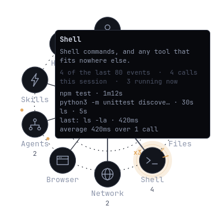 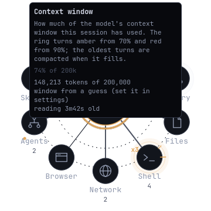
- **Click Files, Memory or Skills** (the station has a faint backlight, and the pointer turns into a hand,
  when there is something to open). **Files** and **Skills** open the file behind a name in your editor
  (`omarchy launch editor`; pictures, video, audio and PDFs go to your default viewer): one name opens
  at once, several are listed to pick from, and a name that matches several files lists those. The log
  keeps no full paths, so the name is looked up on disk at the click: under the session's folder (known
  when claude-strip runs), then Claude's scratch folder, then anywhere under your home folder (not
  Claude's own plugin and transcript folders); skills are looked up in `~/.claude/skills` and the plugin
  folders. **Memory** is always clickable: it lists this project's own memory files (`MEMORY.md` first,
  then the others, newest first), whether or not the session has touched any, since memory is loaded at
  the start without a tool call. Only names are read, and only an existing file in your home folder or
  Claude's scratch folder is ever handed to the editor or viewer (a symlink in a project that points
  outside is refused; skills and plugin folders may link elsewhere, as they usually do); nothing is
  executed. Other stations do nothing on a left click yet.
- **Right-click any station** for its recent calls: up to ten, newest first, each with its name,
  status (`ok`, `err`, `blocked`, `running`), how long it took and how long ago it started, and `agent`
  for a call a subagent made. It covers the last 80 events of the session, so older calls are gone. A station
  with no calls yet shows a short note at the bottom of the window instead. The list is a snapshot from
  the moment of the click; click anywhere else to close it. Names come from the log and show on screen
  only; nothing is written.
- **A thin curve** joining the last seven stations visited (a leg holds 40 s, then fades), and
  **spokes that thicken** with use.
- **A dot circling Agents** per running subagent. A background task keeps its station lit after its
  own turn is over.
- **A wide ring from the hub**: an answer finished. **Rings at the hub and Model**: a model change.
- **The feed** under the map: `●` running, `·` done, `✕` failed or blocked; finished rows at one
  station fold into one with `+N`.

## Options

| What | How | Default |
| --- | --- | --- |
| Context window size | `~/.config/roundhouse/config.json`: `{"contextWindow": "1m"}` (a number, `"200k"`, `"1m"` or `"auto"`); watched, no restart | guessed from the model name, else 200k |
| Colours | follows the Omarchy theme; `ROUNDHOUSE_THEME=/path/to/colors.toml` tries another | the current theme |
| Window size, always on top | edit `hypr/roundhouse.lua` (`size`, `pin`) | 360x680; the all-sessions window pinned, session windows not |
| Keys in the all-sessions window | `[` `]` or arrows step, space lists, `1`-`9` pick, `a` auto, `w` pop out, escape | |
| Where the log lives | `LOT_MAP_DIR` (read by both the emitter and the window) | `$XDG_RUNTIME_DIR/lot-map` |

Not configurable, on purpose: the hub's name and the layout (ten fixed stations).

## The window

```bash
roundhouse                       # the all-sessions window (same as: roundhouse show)
roundhouse toggle ab12cd34       # a window for one session, shown or hidden
roundhouse show|hide [SID]
roundhouse rebind OLD NEW        # a window moves to the session that replaces its own (after /clear)
roundhouse list                  # the sessions in the log, and which have a window
```

(`bin/roundhouse`; put it on your PATH if you like.) The windows that are shown are listed in
`$XDG_RUNTIME_DIR/lot-map/windows.json`. One background process runs them all: the command
starts it when something is to be shown, and it ends by itself when nothing is.

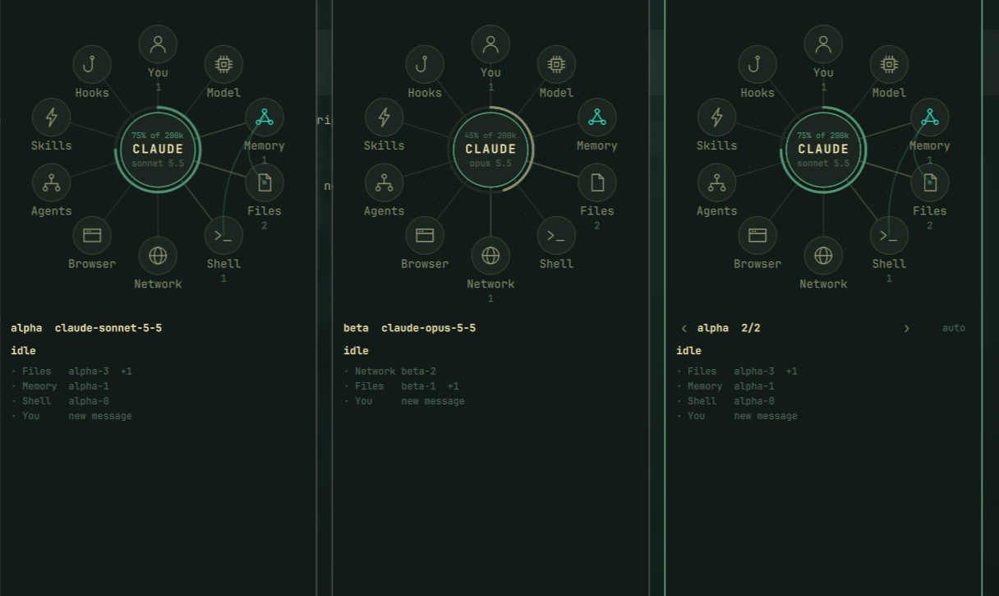

- **The all-sessions window** has the switcher and follows whichever session is most recently
  active (see "Several sessions"). It floats on every workspace. In it, `w` opens the session
  on show in a window of its own.
- **A window for one session** is fixed to it (no switcher), is titled `roundhouse: <folder> · <id>`,
  and is **not** pinned: it opens on the workspace you are on and stays there, so switching
  workspace hides it. It **follows its terminal**: when the terminal is moved to another workspace,
  the window goes along (quietly, within a couple of seconds, without taking the focus); one you
  placed by hand stays put until the terminal moves. It closes itself when its session ends. A `/clear` is not an end: the
  session id changes, and `roundhouse rebind OLD NEW` moves the window to the new one, in
  place. Closing a window with the window manager takes it out of the set.
- The session id is the first 8 characters of Claude Code's, as `roundhouse list` shows.

Quickshell windows all report the app id `org.quickshell`, so the Hyprland rules match on the
title. To float and size them (and pin the all-sessions one), let `./install.sh` add this line to
`~/.config/hypr/hyprland.lua` when it asks (or add it yourself; remove it to undo):

```lua
dofile("/path/to/roundhouse/hypr/roundhouse.lua")   -- the absolute path of your clone; the installer writes it for you
```

To try the rules for one session without editing anything:
`hyprctl eval 'dofile("/path/to/roundhouse/hypr/roundhouse.lua")'` (your clone's path).
Requires `quickshell`.

The windows tail the log with `tail -F` (one tail, shared) and fold each line into a board per
session (`ui/board.js`): calls are paired by id, a call still open at the next `batch` or `stop`
is marked blocked (background calls too), the newest 80 entries are kept, and each window
shows its session. It copes with a log that does not exist yet and with the emitter cutting
the log back (the replayed lines are recognised and skipped).


The map (`ui/MapView.qml`, icons in `ui/icons.js`) is drawn on a Canvas from the window's size,
so it scales: ten stations on an ellipse with You at the top and the rest clockwise, a spoke
to each, dashed contour rings, an icon and label per station with the number of recent calls
under it, and the model name in the hub. Colours come from the Omarchy theme (see "Theme"). Icons
are original line drawings.

### The session header

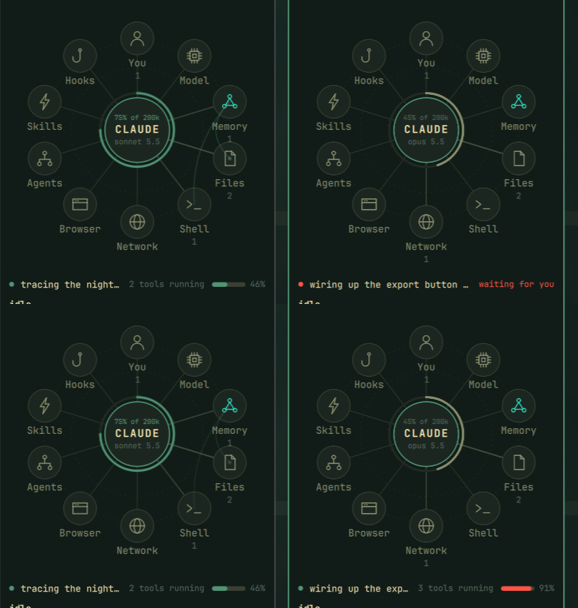

A window for one session starts with the same text as that session's
[claude-strip](https://github.com/TaylorBurke/claude-strip): a dot for the phase, the task
title, then `waiting for you` or the number of tools running, and the context bar with its
percentage. So a terminal and its map are easy to pair up. Clicking the header focuses the
terminal. The window title uses the strip's project name.

It needs claude-strip 0.4 or later, whose session-strip mod writes the session id into its
state file (`tools/strip_state.py` reads those files, read-only, every two seconds while such a
window is shown). Without it the header just names the folder and the model, and everything
else works the same.

**One thing to know:** the task title is a summary of your prompts. It is shown in the window
and nowhere else: roundhouse never writes it to its log, and the hook emitter is unchanged.

### Opening a session's window from its strip

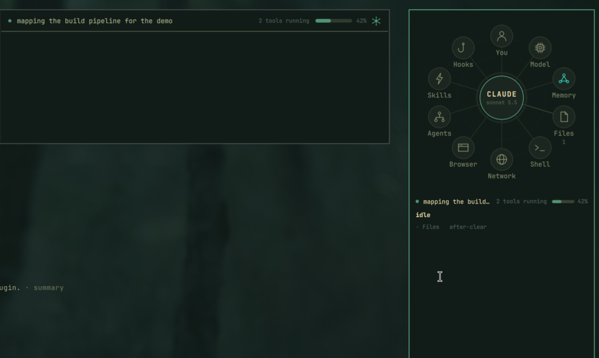

With [claude-strip](https://github.com/TaylorBurke/claude-strip) 0.4, each strip gets a small
icon at its far right (shown when the `roundhouse` command is on your PATH). Click it to open or
close that session's window; it is lit while the window is open. After a `/clear` the strip
notices the new session id and runs `roundhouse rebind`, so the window carries on in the same
place. Everything the icon does is the command line above, so it works the same by hand.

The strip's side is merged on claude-strip's `main` branch (v0.4.0). Its Omarchy marketplace
update is still to come, so until then use a clone of that repository for the strip.

### Context ring and the model

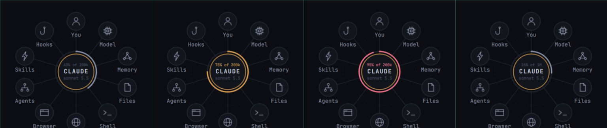

The ring around the hub is how full the context window is: grey, amber from 70%, red from
90%, with the percentage and the assumed window ("75% of 200k") in the hub and the model's
short name under "CLAUDE". The transcript does not say whether you run the 200k or the 1M
window, so it is a guess from the model name (a `1m` in it means 1M) and grows to 1M if more
than 200k tokens turn up. To set it, create `~/.config/roundhouse/config.json`
(`$XDG_CONFIG_HOME` is honoured; the file is watched, so no restart):

```json
{ "contextWindow": "1m" }
```

A number (`1000000`), `"200k"`, `"1m"` or `"auto"` all work; a missing or broken file means auto.


A model change rings the hub and the Model station for a few seconds. A compaction lights
Model and labels it "compacting"; afterwards the ring is dashed with "\u2013%" until the next
real reading, because the transcript still holds the old numbers right after a compaction.

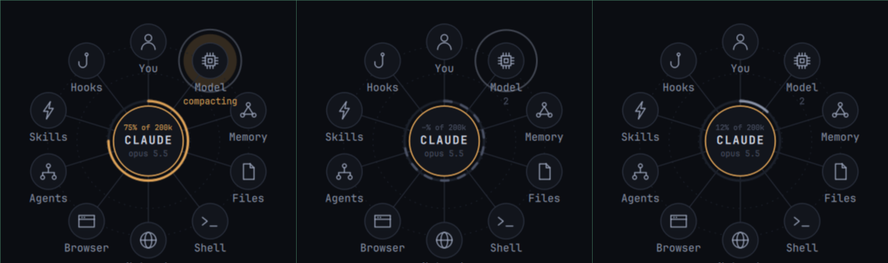

### Route line and worn spokes


A thin curve joins the last seven stations the main loop visited (subagent calls and repeats at
the same station are left out). The newest leg draws itself; a leg holds at full strength for 40
seconds, then fades over 20. Spokes grow thicker and brighter with use, on a log scale: one
call is a hint, around sixty is full.


### Error dots, clock hands and parallel calls

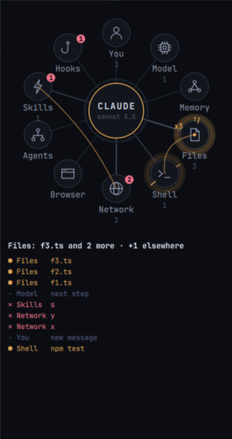

- A failed call puts a red dot with a count on its station. A refused call (a hook said no, or
  you did not grant it) marks its station and also Hooks, which is where `ask`, `denied` and
  refusals the log only implies are accounted for. A refusal later found to be a slow call
  taking its dot back, and the next prompt clears them all.
- While a call runs, two hands circle its station: the long one makes a lap a minute, the short
  one a lap in ten, counted from the oldest running call there.
- Calls that start together fly in side-by-side lanes, and the station shows `x3` while that
  many run at once.

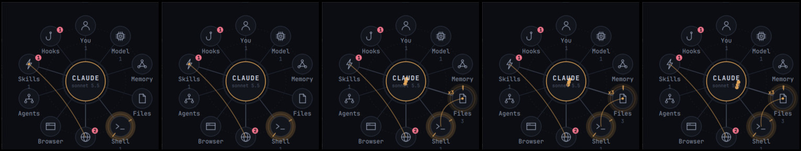

### Background tasks and subagents

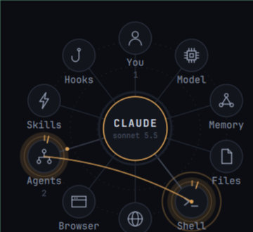

- A call that started a background task keeps its station lit, with clock hands, after its own
  turn is over: until the task reports back, or until an answer arrives that no longer lists it
  as running. A task that failed leaves a red dot.
- Each running subagent is a small dot circling the Agents station, and the calls it makes fly
  out from Agents instead of from the hub. Claude Code's own internal agents, which end without
  ever starting, are ignored.

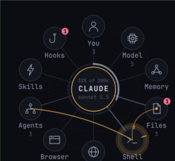

### Theme

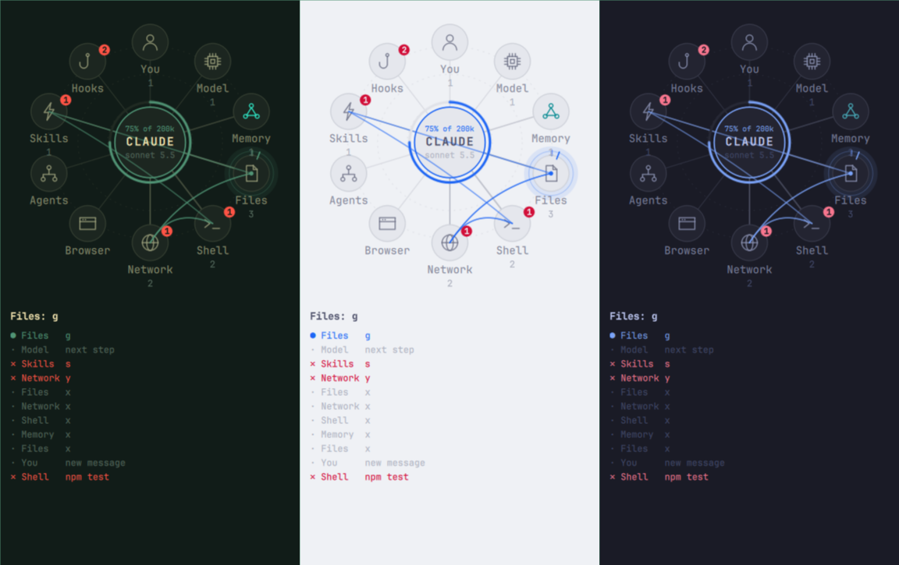

The window follows the Omarchy theme: it reads `~/.local/state/omarchy/current/theme/colors.toml`
(`accent`, `background`, `foreground`, `muted`, `red`, `cyan` (read, but the Memory icon now matches the others),
`mode`) and mixes the rest of its surfaces and text from background and foreground, so light
themes work too. Without a theme file it uses a built-in dark palette.

A theme switch replaces files, symlinks, even the folder, which can leave a file watcher
looking at a deleted file; so the file is watched *and* re-read every two seconds (a few
hundred bytes). While the file is briefly missing mid-switch the current colours stay.

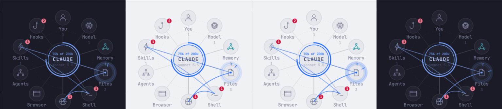

To try a theme without switching your desktop, point `ROUNDHOUSE_THEME` at any `colors.toml`:
`ROUNDHOUSE_THEME=/usr/share/omarchy/themes/catppuccin-latte/colors.toml bin/roundhouse`.

### Several sessions

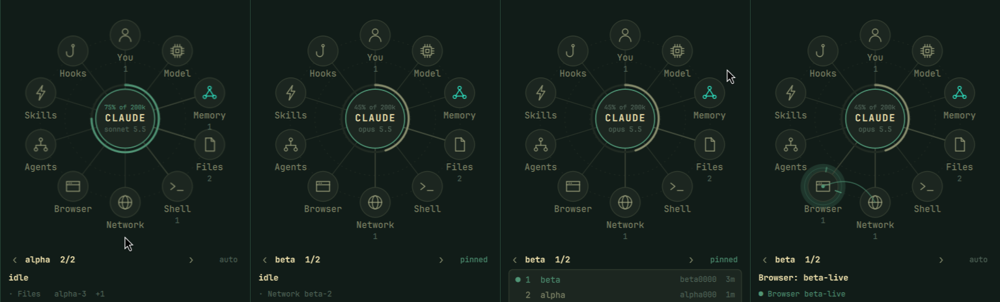

A bar under the map names the session on show (its folder) and where it sits among the live
ones (`2/3`). By default the window follows whichever session was active most recently
(`auto`); stepping to another one pins it (`pinned`) until you go back to auto. A session
that ended, or has been quiet for 30 minutes, is not listed. If the one you pinned ends, the
window falls back to auto. Only the session on show pulses.

- **Mouse:** `‹` `›` step through sessions, the name opens the list, `pinned` goes back to auto.
- **Keyboard** (click the window first): `[` `]` or the arrow keys step, space opens the
  list and `1`-`9` pick from it, `a` is auto, escape closes the list.

### Pulses and the feed


- A call starting sends a dot from the hub out along its spoke and ripples the station; the
  call ending sends one back, red if it failed. A station with a call running keeps a soft
  amber glow.
- A prompt pulses You and sends a dot on to Model; each step between tool batches pulses
  Model; a finished answer sends a wide ring out from the hub.
- A call that was refused (still open when the next step or the answer arrives) flashes red at
  its station and shows as a red ✕ row. That includes background calls: only their task
  outlives the call.
- Under the map, one line says what is happening now ("Files: a.ts and 2 more · +1
  elsewhere"), and below it the last 16 rows read ● running, · done, ✕ failed or blocked.
  Finished rows that follow each other at one station are folded into one row with `+N`.
- Only events from the last few seconds pulse, so opening the window on an old log does not
  replay it.

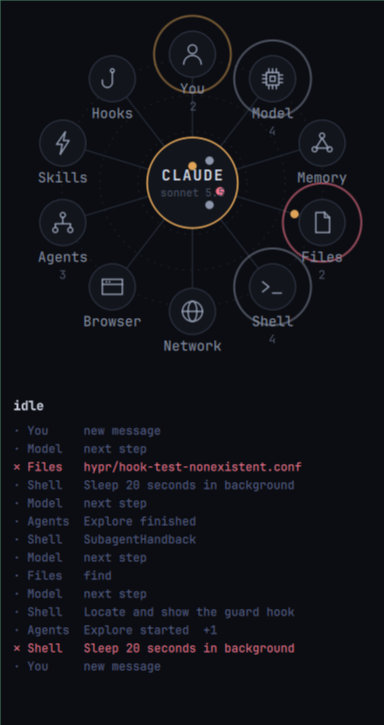

To watch a recorded log play back (for development and screenshots), point a second log
directory at the window and replay into it:

```bash
LOT_MAP_DIR=/tmp/rh-demo bin/roundhouse &
tools/replay.py recorded.jsonl /tmp/rh-demo --sid 520a9593
```

## The log viewer

```
bin/lot-map-log              follow, starting with the last 20 events
bin/lot-map-log -n 0         only new events
bin/lot-map-log --no-follow  print what is there and exit
bin/lot-map-log --raw        the JSON lines as they are
bin/lot-map-log -s 7c8862de  one session only
```

```
23:32:53.486 7c8862de ● Files    e2e/sample.txt
23:32:53.659 7c8862de · Files    e2e/sample.txt  6 ms
23:32:53.755 7c8862de ◌ Model    context 42,129 tokens · claude-haiku-5-5
23:32:57.984 7c8862de ✕ Shell    Run false command (expected to exit non-zero)  9 ms
23:32:59.390 7c8862de ? Hooks    asked permission: Bash
23:33:01.751 7c8862de ◂ You      answer ready
```

## Requirements

- Linux with Hyprland and `quickshell` (Omarchy has both); Python 3 (standard library only).
- Claude Code 2.1.295 or later is recommended (the hook events used are listed in `docs/DESIGN.md`).
- Optional: [claude-strip](https://github.com/TaylorBurke/claude-strip) 0.4 or later, for the
  session header and the map icon.
- To run the tests: `qml6` and `qmltestrunner` (both in `qt6-declarative`).

## Tests

```bash
python3 -m unittest discover -s tests
```

Covers the emitter, the board logic and the theme (QML run under `qml6`),
the switcher and session header (clicks through Qt's input system, under `qmltestrunner`), the window
list, the strip reader, the transcript reader (`tools/transcript.py`, read-only, fake home and fixture transcripts), and the installer (including an exact install-then-uninstall round trip).
The terminal log viewer (`bin/lot-map-log`) has no tests of its own. A real mouse on a real Wayland window is not covered: the clicks are tested in Qt, the rest of the
window by hand with scripted events.

## Credit

The idea and the look are from [lot-map](https://github.com/alexeyw/lot-map) by alexeyw (MIT), a
Claude Code plugin that draws this map in the desktop app. roundhouse is a separate project for
Linux terminals, fed by ordinary Claude Code hooks; its code and icons are written fresh.

## License

[MIT](LICENSE)
