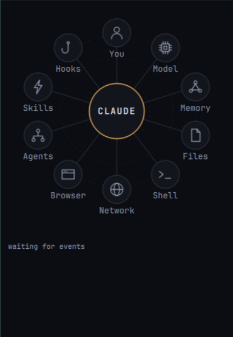
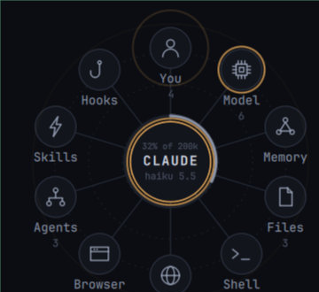
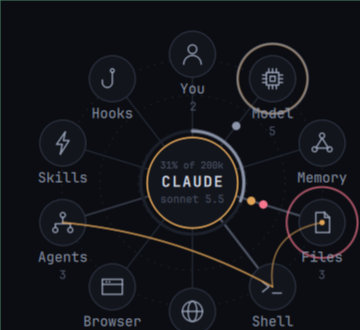
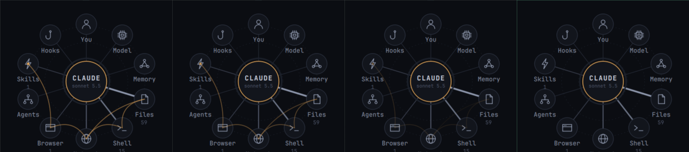

# roundhouse

A live map of what Claude Code is doing, in a floating window on a Linux desktop
(built for Omarchy / Hyprland). A hub in the middle, stations around it (You, Model,
Memory, Files, Shell, Network, Browser, Agents, Skills, Hooks), and a pulse along a
spoke for every tool call.

Inspired by [lot-map](https://github.com/alexeyw/lot-map) by alexeyw (MIT), a Claude
Code plugin that draws this map in the desktop app. In a terminal session that plugin
shows only its text feed; this project gets the picture on screen anyway, fed by
ordinary Claude Code hooks. The code here is written fresh.

**Status: stage 3 of 5 done, waiting for review.** The hook emitter, a terminal log viewer and a
floating window work: the map pulses as Claude Code works, with a one-line current action and
a feed underneath. No context ring, route line or theme yet (stage 4), nothing is installed
into your Claude Code settings.

| Stage | What | State |
| --- | --- | --- |
| 1 | Research and design ([docs/DESIGN.md](docs/DESIGN.md)) | done |
| 2 | Hook emitter and terminal log viewer | done |
| 3 | Window with the static map and live pulses | done, for review |
| 4 | Context ring, route line, error dots, background tasks, subagents, theme | context ring (#6), route line and worn spokes (#7), error dots, clock hands and parallel lanes (#8) done; rest next |
| 5 | Install and uninstall scripts | |

## How it works

```
Claude Code hook  ->  hooks/emit.py  ->  $XDG_RUNTIME_DIR/lot-map/events.jsonl  ->  viewer / window
```

`hooks/emit.py` runs on each hook event, turns it into one small JSON line and appends
it to the log. The log lives on tmpfs, is readable only by you, and is cut back to its
newest 500 lines when it passes 1 MB.

## What is recorded

Names only, never content:

- a file: the last two parts of its path
- a web address: the host alone
- a shell command: the short description Claude gave it, or the command's name; never
  the command line
- a subagent: its short description
- a background task: its id, type and status
- the context window: a token count and the model name, read from the session
  transcript's usage numbers

Prompts, command lines, file contents, tool output and memory text are never written.
Control characters are stripped from every label. The emitter makes no network calls,
starts no processes, prints nothing and always exits 0, and the hooks are registered as
`async`, so they cannot hold up or alter a tool call.

## Try it without installing

Nothing here touches `~/.claude/settings.json`. To see events flow, give one session a
settings file of its own:

```bash
# 1. a settings file that points every event at the emitter
python3 - > /tmp/roundhouse-hooks.json <<'EOF'
import json
events = ["SessionStart", "UserPromptSubmit", "PreToolUse", "PostToolUse", "PostToolUseFailure",
          "PostToolBatch", "PermissionRequest", "PermissionDenied", "SubagentStart", "SubagentStop",
          "Stop", "StopFailure", "PreCompact", "PostCompact", "PostModelSwitch", "Notification", "SessionEnd"]
hook = {"type": "command", "command": "/home/YOU/Work/lot-map-linux/hooks/emit.py", "async": True}
print(json.dumps({"hooks": {e: [{"hooks": [hook]}] for e in events}}, indent=1))
EOF

# 2. in one terminal, follow the log
bin/lot-map-log

# 3. in another, start a session with those hooks
claude --settings /tmp/roundhouse-hooks.json
```

To undo: close that session and delete `/tmp/roundhouse-hooks.json`. The log disappears
at logout, or remove it with `rm -r "$XDG_RUNTIME_DIR/lot-map"`.

## The window

```bash
bin/roundhouse    # opens the window; closing it ends the process
```

Quickshell windows all report the app id `org.quickshell`, so the Hyprland rule matches on
the title `roundhouse` as well. To float, size (360x680) and pin it, add this line to
`~/.config/hypr/hyprland.lua` (remove it to undo):

```lua
dofile(os.getenv("HOME") .. "/Work/roundhouse/hypr/roundhouse.lua")
```

To try the rule for one session without editing anything:
`hyprctl eval 'dofile(os.getenv("HOME") .. "/Work/roundhouse/hypr/roundhouse.lua")'`.
Requires `quickshell`.

The window tails the log with `tail -F` and folds each line into a board per session
(`ui/board.js`): calls are paired by id, a call still open at the next `batch` or `stop`
is marked blocked (background calls are not), the newest 80 entries are kept, and the most
recently active session is shown. It copes with a log that does not exist yet and with the
emitter cutting the log back (the replayed lines are recognised and skipped).



The map (`ui/MapView.qml`, icons in `ui/icons.js`) is drawn on a Canvas from the window's size,
so it scales: ten stations on an ellipse with You at the top and the rest clockwise, a spoke
to each, dashed contour rings, an icon and label per station with the number of recent calls
under it, and the model name in the hub. Colours are properties on `MapView`, ready for the
theme work. Icons are original line drawings.

### Context ring and the model


The ring around the hub is how full the context window is: grey, amber from 70%, red from
90%, with the percentage and the assumed window ("75% of 200k") in the hub and the model's
short name under "CLAUDE". The transcript does not say whether you run the 200k or the 1M
window, so it is a guess from the model name (a `1m` in it means 1M) and grows to 1M if more
than 200k tokens turn up. To set it, create `~/.config/roundhouse/config.json`
(`$XDG_CONFIG_HOME` is honoured; the file is watched, so no restart):

```json
{ "contextWindow": "1m" }
```

A number (`1000000`), `"200k"`, `"1m"` or `"auto"` all work; a missing or broken file means auto.



A model change rings the hub and the Model station for a few seconds. A compaction lights
Model and labels it "compacting"; afterwards the ring is dashed with "\u2013%" until the next
real reading, because the transcript still holds the old numbers right after a compaction.


### Route line and worn spokes



A thin curve joins the last seven stations the main loop visited (subagent calls and repeats at
the same station are left out). The newest leg draws itself; a leg holds at full strength for 40
seconds, then fades over 20. Spokes grow thicker and brighter with use, on a log scale: one
call is a hint, around sixty is full.



### Error dots, clock hands and parallel calls


- A failed call puts a red dot with a count on its station. A refused call (a hook said no, or
  you did not grant it) marks its station and also Hooks, which is where `ask`, `denied` and
  refusals the log only implies are accounted for. A refusal later found to be a slow call
  taking its dot back, and the next prompt clears them all.
- While a call runs, two hands circle its station: the long one makes a lap a minute, the short
  one a lap in ten, counted from the oldest running call there.
- Calls that start together fly in side-by-side lanes, and the station shows `x3` while that
  many run at once.


### Pulses and the feed


- A call starting sends a dot from the hub out along its spoke and ripples the station; the
  call ending sends one back, red if it failed. A station with a call running keeps a soft
  amber glow.
- A prompt pulses You and sends a dot on to Model; each step between tool batches pulses
  Model; a finished answer sends a wide ring out from the hub.
- A call that was refused (still open when the next step or the answer arrives) flashes red at
  its station and shows as a red ✕ row. That includes background calls: only their task
  outlives the call.
- Under the map, one line says what is happening now ("Files: a.ts and 2 more · +1
  elsewhere"), and below it the last 16 rows read ● running, · done, ✕ failed or blocked.
  Finished rows that follow each other at one station are folded into one row with `+N`.
- Only events from the last few seconds pulse, so opening the window on an old log does not
  replay it.


To watch a recorded log play back (for development and screenshots), point a second log
directory at the window and replay into it:

```bash
LOT_MAP_DIR=/tmp/rh-demo bin/roundhouse &
tools/replay.py recorded.jsonl /tmp/rh-demo --sid 520a9593
```

## The log viewer

```
bin/lot-map-log              follow, starting with the last 20 events
bin/lot-map-log -n 0         only new events
bin/lot-map-log --no-follow  print what is there and exit
bin/lot-map-log --raw        the JSON lines as they are
bin/lot-map-log -s 7c8862de  one session only
```

```
23:32:53.486 7c8862de ● Files    e2e/sample.txt
23:32:53.659 7c8862de · Files    e2e/sample.txt  6 ms
23:32:53.755 7c8862de ◌ Model    context 42,129 tokens · claude-haiku-5-5
23:32:57.984 7c8862de ✕ Shell    Run false command (expected to exit non-zero)  9 ms
23:32:59.390 7c8862de ? Hooks    asked permission: Bash
23:33:01.751 7c8862de ◂ You      answer ready
```

## Requirements

Python 3 (standard library only); `quickshell` for the window; `qml6` (qt6-declarative) to run the board tests. Claude Code 2.1.295 or later is recommended.

## Tests

```bash
python3 -m unittest discover -s tests   # includes tests/board.test.qml, run under qml6
```

## License

[MIT](LICENSE)
